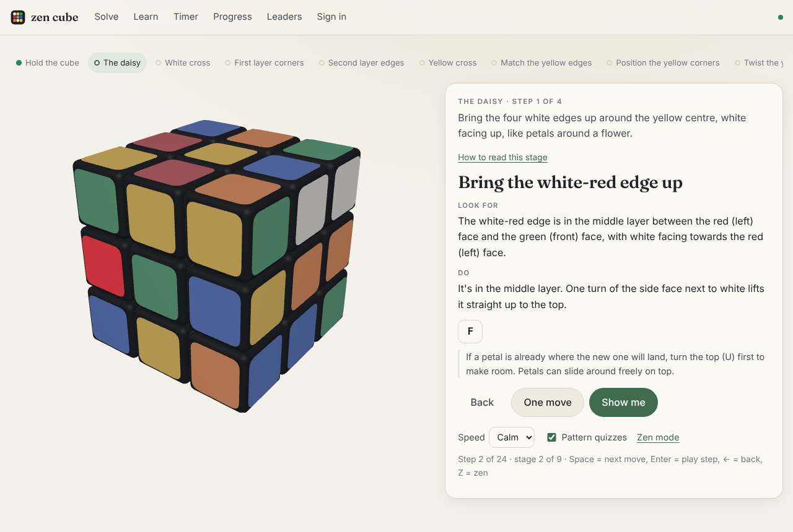
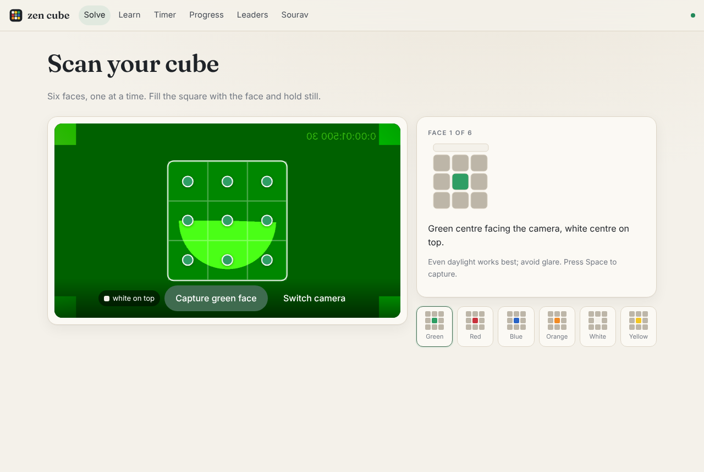
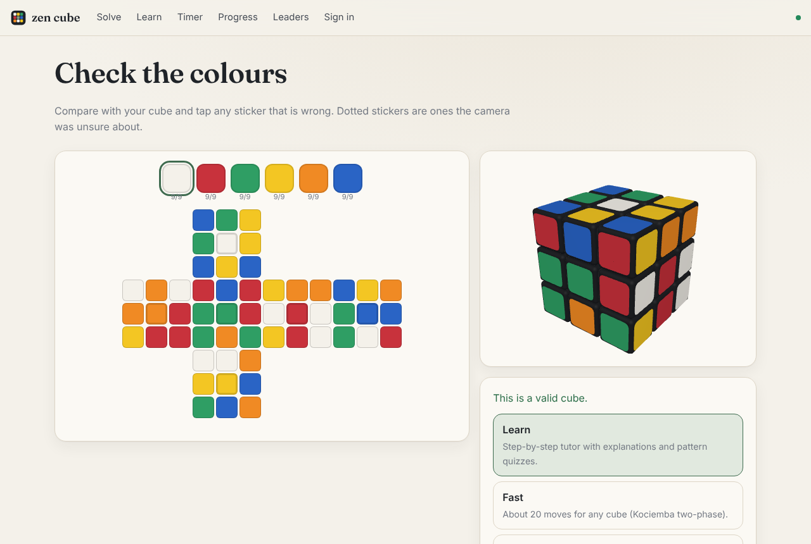
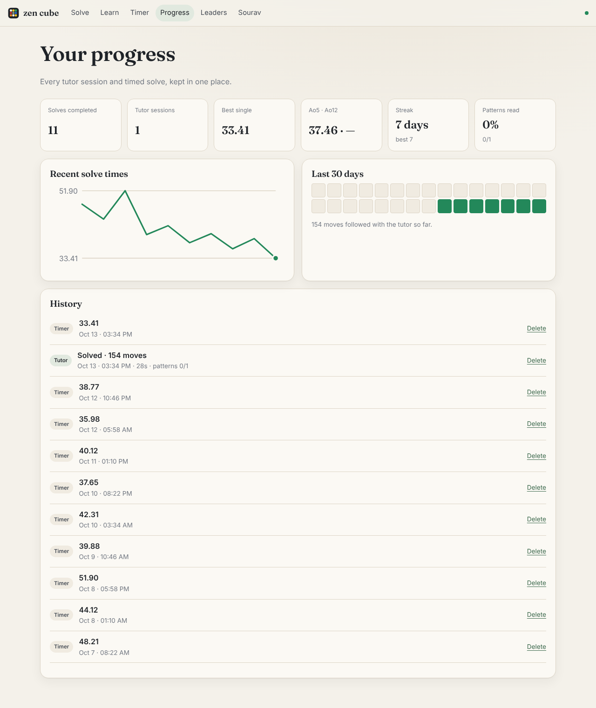

# Zen Cube

Scan a Rubik's Cube with your phone or laptop camera, then learn to solve it with a step-by-step beginner tutor.

**Live:** https://zen-cube-solver.netlify.app (frontend). The API runs on Render's free tier and sleeps when idle, so the first request after a while takes about a minute.



This started as a C++ solver I wrote to study search algorithms (BFS, DFS, IDDFS and IDA\* with Korf's corner pattern database). That code is still here in `engine/`, now with its bugs fixed. Around it there is now a C++ HTTP service and a React frontend.

## What it does

- **Camera scan.** You show each face to the camera. Each sticker is matched against the six centre colours of your own cube, under the constraint that every colour appears exactly nine times. You then fix anything it got wrong on an editable net.
- **Validation.** Before solving, the server checks the cube can actually exist. It explains any problem in plain terms, for example "one edge is flipped" or "there are 10 white stickers", and highlights the stickers involved.
- **Three solvers.**
  - *Learn*: the layer-by-layer beginner method. It has nine stages, and every step comes with what to look for, what to do, the moves, and the piece to watch. Optional quiz questions ask you to read the cube first ("the white sticker points right: how many times do you repeat R U R' U'?").
  - *Fast*: Kociemba's two-phase algorithm, about 21 moves for any cube.
  - *Optimal*: the original engine's IDA\* with the corner database. It finds the shortest solution for cubes up to about 9 moves from solved, and falls back to Fast for deeper ones.
- **3D player.** Each step's moves animate on a Three.js cube while the relevant piece is highlighted. A zen mode shows only the cube and the next move.
- **Timer and progress.** There is a WCA-style timer with random-state scrambles. With an account you also get history, best single, Ao5/Ao12, daily streaks, quiz accuracy and a leaderboard. It works without an account, and anything saved locally moves to your account when you sign in.

| Scan | Review | Progress |
| --- | --- | --- |
|  |  |  |

## How it's built

```
frontend/  React 19 + TypeScript + Vite + Three.js    -> Netlify
backend/   C++17 HTTP service (cpp-httplib)          -> Render (Docker)
  src/core/     cube models, validation, Kociemba, beginner tutor, engine adapter
  src/server/   routes, services, storage (Postgres / in-memory), infra
engine/    the original solver (models, BFS/DFS/IDDFS/IDA*, pattern database)
docs/      design notes, API, algorithms, deployment
```

A request to `/api/v1/solve` goes through these steps:
1. Validation.
2. An LRU cache. Solutions depend only on the input, so they never go stale.
3. Request coalescing, so identical concurrent requests share one solve.
4. A bounded worker pool with load shedding.
5. The solver, under a deadline.

Accounts use salted PBKDF2 password hashes and stateless JWTs. Runs are stored in Postgres, and history pages use keyset pagination. The details and trade-offs are in [docs/SYSTEM_DESIGN.md](docs/SYSTEM_DESIGN.md).

## Numbers

Measured with `zencube_bench` (500 random-state cubes) and local HTTP tests:

| | moves (mean / max) | time p50 | time p95 |
| --- | --- | --- | --- |
| Kociemba two-phase | 20.8 / 21 | 3.4 ms | 64 ms |
| Beginner tutor | 163 / 217 face turns | 0.25 ms | 0.64 ms |
| IDA\*, 8-move scrambles | optimal | 10.7 ms | (max 533 ms) |

- The full corner pattern database (88,179,840 states, 11 moves deep) builds in about 9 s at image build time.
- Under Render free-tier limits (0.1 CPU, 512 MB) the container is ready about 5 s after start and uses 52 MB of RAM.
- Cached solves take about 1 ms server-side.

## Run it locally

Requirements: CMake 3.16+, a C++17 compiler, OpenSSL, libpq and GoogleTest (`apt install cmake ninja-build libssl-dev libpq-dev libgtest-dev`), and Node 22.

```bash
# backend
cmake -S . -B build -G Ninja
cmake --build build
./build/backend/zencube_tests                                  # 64 tests
./build/backend/src/server/zencube_server --build-tables --data-dir data   # optional: enables Optimal
DATA_DIR=data ./build/backend/src/server/zencube_server       # http://localhost:8080

# frontend
cd frontend && npm install && npm run dev                      # http://localhost:5173
```

Without `DATABASE_URL` the server keeps accounts and runs in memory. To use Postgres locally, set `DATABASE_URL=postgresql://...`; the server creates its tables on start.

The original CLI still works: `./build/engine/rubiks_cli --solver ida --scramble 7`.

## Deploying

[docs/DEPLOYMENT.md](docs/DEPLOYMENT.md) has the step-by-step version:
- **Database**: create a free Neon Postgres database.
- **Backend**: on Render, choose New → Blueprint and select this repo (`render.yaml`), then paste the Neon URL when asked.
- **Frontend**: deploys to Netlify from `netlify.toml`.

## Docs

- [System design](docs/SYSTEM_DESIGN.md): architecture, request path, caching, failure handling, data model, scaling.
- [API](docs/API.md): endpoints, request/response examples, error codes.
- [Algorithms](docs/ALGORITHMS.md): facelet model, beginner method, Kociemba, IDA\* and the pattern database, colour classification.
- [Engine fixes](docs/ENGINE_FIXES.md): bugs found in the original solver and how they were confirmed.

## Credits

- Kociemba's two-phase algorithm: Herbert Kociemba, http://kociemba.org/cube.htm
- IDA\* with pattern databases: Richard Korf, *Finding Optimal Solutions to Rubik's Cube Using Pattern Databases* (1997).
- [cpp-httplib](https://github.com/yhirose/cpp-httplib) and [nlohmann/json](https://github.com/nlohmann/json), both MIT, vendored in `backend/third_party`.

MIT licensed, see [LICENSE](LICENSE).
