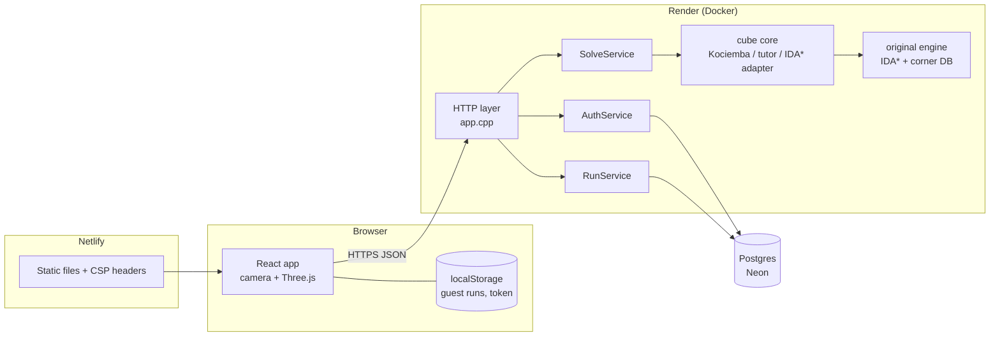

# System design

This document explains how Zen Cube is put together and why. It is written for someone reviewing the code, so each section names the files involved.

## Constraints

The project has to run for free. That decides most of the design:

| Constraint | Consequence |
| --- | --- |
| Render free web service: 0.1 CPU, 512 MB RAM, sleeps after 15 min idle, no persistent disk | Precompute heavy tables at image build time; start answering health checks immediately; cap concurrent solves; nothing stored on local disk |
| Render free Postgres is deleted after 30 days | Use an external Postgres (Neon free tier) through `DATABASE_URL` |
| Neon/Render allow only a few DB connections | Small fixed connection pool (3 by default) |
| A cold start takes about a minute | The frontend pings the API on page load and shows a "server starting" state |

Functional requirements: scan or enter a cube, validate it, solve it three ways, play the solution step by step, and optionally keep history and stats per user. Non-functional: a solve request should never tie up the server indefinitely, one user should not be able to starve others, and the app should stay usable (as a guest) if the database is down.

## Architecture



The backend has three layers, and dependencies only point downwards:

1. **HTTP layer** (`backend/src/server/api/app.cpp`): parses requests, runs middleware, maps errors to a standard JSON envelope. No business logic.
2. **Services** (`backend/src/server/services/`): `SolveService`, `AuthService`, `RunService`. They contain the rules (validation, caching, limits, stats).
3. **Storage and core**: repositories behind interfaces (`repo/repositories.h`), and the cube library (`backend/src/core/`), which knows nothing about HTTP.

`bootstrap.cpp` is the only file that picks concrete implementations (Postgres or in-memory storage, whether the optimal solver is available). Everything else receives its dependencies through constructors, which is what lets the tests run the full HTTP stack against the in-memory store.

The original solver in `engine/` is used as-is through one adapter file (`core/optimal.cpp`). Its headers put `using namespace std` in scope and use their own types, so keeping them out of the rest of the code base avoids leaking that into every translation unit.

## The solve path

`POST /api/v1/solve {cube, method, colorNames}`:

```mermaid
sequenceDiagram
    participant C as Client
    participant A as app.cpp
    participant S as SolveService
    participant K as Solver
    C->>A: POST /solve
    A->>A: request id, CORS, per-IP rate limits
    A->>S: solve(request)
    S->>S: validateCube (422 with highlighted stickers if impossible)
    S->>S: LRU cache lookup (hit: return, X-Cache: HIT)
    S->>S: singleflight on cache key
    S->>S: acquire bulkhead slot (wait up to 2 s, else 503 + Retry-After)
    S->>K: solve with deadline (4 s; optimal 3 s)
    K-->>S: moves, or budget exceeded
    S->>S: optimal over budget: run Kociemba instead, mark fallbackFrom
    S-->>A: JSON
    A-->>C: 200
```

Why each step is there:

- **Validation first.** A scan error is the most likely failure. Rejecting impossible cubes early gives the user a useful message, for example "the corners are twisted in a way turning cannot produce", together with the stickers to check. It also guarantees the solvers only see solvable input.
- **Cache.** Solving is a pure function of (method, cube state, colour names for the tutor text), so results can be cached forever. A bounded LRU (2,000 entries by default) keeps memory predictable. A hit costs about 1 ms instead of up to tens of milliseconds for Kociemba.
- **Singleflight.** If several requests for the same uncached cube arrive together (a shared scramble, a client retrying), only one solve runs and the others wait for its result. Without it, a cache miss under load would run the same search N times.
- **Bulkheads.** There are two counting semaphores: one for all solves (`MAX_CONCURRENT_SOLVES`, 2 on Render) and a separate one with capacity 1 for optimal searches. An optimal search can run for seconds, so without its own pool a handful of them could hold every solve slot. A request that can't get a slot within 2 s gets `503` with `Retry-After` instead of waiting indefinitely.
- **Deadlines.** Every search checks a `SearchBudget` (deadline, node cap, shutdown flag) every few thousand nodes. No request can hold a thread past its deadline.
- **Fallback.** IDA\* time grows exponentially with solution depth. Optimal is only practical up to about 9 moves, and a scanned cube is usually 17–20 moves from solved. Instead of failing, the service returns a Kociemba solution with `fallbackFrom: "optimal"` and a reason the UI shows.

I tested this under load locally: 40 concurrent optimal requests for random cubes, with a 1.5 s optimal budget. 8 were answered, each falling back to Kociemba after the budget. 32 were rejected within the 2 s queue wait. Meanwhile the server stayed responsive to other requests. The counters are visible on `/metrics` (`bulkhead_rejections_total`, `solver_fallbacks_total`).

`GET /api/v1/solve?cube=...&method=...` returns the same body with `Cache-Control: public, max-age=31536000, immutable`, so a CDN could cache solutions too.

## Accounts and runs

**Passwords** are hashed with PBKDF2-HMAC-SHA256 (OpenSSL) with a random 16-byte salt and 150,000 iterations. The stored format is `pbkdf2_sha256$iterations$salt$hash`, so the iteration count can be raised later; hashes are upgraded on the next successful login. Hashing is deliberately slow, so it gets its own bulkhead (2 concurrent), and the login and register routes have a stricter per-IP rate limit (10 per minute). Login runs one PBKDF2 verification even when the email doesn't exist, so response time doesn't reveal which emails are registered.

**Sessions** are HS256 JWTs signed with `JWT_SECRET` (Render generates it). The verifier compares signatures in constant time, pins the algorithm (a token whose header says `alg: none` is rejected), and checks issuer and expiry. Tokens are stateless, so any instance can verify them without a session store. The trade-off is that a token can't be revoked before it expires (7 days). If that mattered, the next step would be short-lived access tokens plus a refresh token stored server-side.

The frontend keeps the token in `localStorage`. An httpOnly cookie would be safer against XSS, but the frontend (netlify.app) and API (onrender.com) are on different sites, and third-party cookies are increasingly blocked. The strict CSP on the frontend (`script-src 'self'`) reduces the XSS risk.

**Runs** are one table:

```sql
users(id BIGSERIAL PK, email TEXT UNIQUE, display_name, password_hash, created_at)
runs(id BIGSERIAL PK, user_id → users ON DELETE CASCADE,
     kind CHECK (kind IN ('tutor','fast','optimal','timer')),
     method, facelets, scramble, move_count, duration_ms, completed,
     quiz_correct, quiz_total, steps_completed, total_steps,
     client_id, created_at,
     UNIQUE (user_id, client_id))
INDEX runs_user_created_idx ON runs (user_id, created_at DESC, id DESC)
INDEX runs_timer_idx ON runs (user_id, duration_ms) WHERE kind = 'timer' AND completed
```

- **Idempotent writes.** Clients send a `client_id` (UUID) with each run. The insert is `ON CONFLICT (user_id, client_id) DO NOTHING`, followed by a read of the existing row. A retried request, or a guest's local runs uploaded twice, never creates duplicates. This is what makes guest mode safe: runs recorded while signed out (or while the API was unreachable) sit in `localStorage` and are uploaded in one `POST /runs/batch` on sign-in.
- **Keyset pagination.** History pages use `WHERE (created_at, id) < ($cursor)` ordered by the same columns. Each page is an index range scan regardless of how deep you page, and inserting new runs doesn't shift pages the way `OFFSET` does. The cursor is opaque (base64url of `createdAtMs:id`). `created_at` is stored at millisecond precision so the cursor round-trips exactly.
- **Stats** are computed in one aggregate query plus two small ones: the last 12 timer results for Ao5/Ao12 (WCA rule: drop best and worst), and distinct active days for streaks. That is cheap at this scale. With many runs per user, I'd maintain a per-user summary row on write instead.
- **Leaderboard** is the best completed timer single per user (at least 1 s, to drop junk). It is read-heavy and changes slowly, so the service caches it for 30 s and the response carries `Cache-Control: public, max-age=30`.

**Migrations** are numbered SQL blocks in `pg_repo.cpp`, applied at startup inside a transaction and recorded in `schema_migrations`. They run under `pg_advisory_lock`, so if two instances start at once, one migrates and the other waits.

## Storage abstraction

`UserRepository` and `RunRepository` are interfaces with two implementations:

- `memory_repo.cpp` for local development and tests (and as a fallback when `DATABASE_URL` is unset);
- `pg_repo.cpp`, which uses libpq through a small pool (`pg_pool.cpp`). All user input goes through `PQexecParams` with `$n` parameters, never string concatenation. Broken connections are reset, and a failed query is retried once on a fresh connection, which covers serverless Postgres dropping idle connections.

The same contract tests (`backend/tests/repo_test.cpp`) run against both. CI runs them against a real Postgres 16 service container. Running them locally against Postgres caught a real bug the in-memory store hid: libpq's extended protocol rejects multi-statement SQL, which broke the migrations.

## Failure handling

| Failure | What happens |
| --- | --- |
| Impossible cube (scan error) | 422 `INVALID_CUBE` with issue list and sticker indices; the review screen highlights them |
| Solver too slow | Optimal falls back to Kociemba; Kociemba or beginner over budget gives 504 `SOLVER_TIMEOUT` |
| Too many concurrent solves | 503 `BUSY` + `Retry-After: 2` within 2 s, instead of an ever-growing queue |
| One client sending too much | Token-bucket rate limits per IP: all routes 10 rps (burst 40), solve 2 rps (burst 10), auth 10/min; 429 + `Retry-After` |
| Database down at startup | Exponential backoff for about 30 s; if it still fails, `/readyz` reports the error and Render keeps the previous deploy |
| Database down later | 503 `STORAGE_UNAVAILABLE` for account routes; solving still works; the frontend keeps runs locally and syncs later |
| API asleep / unreachable | Frontend retries with backoff, shows "server starting"; the timer and learn page work offline |
| Deploy / restart | SIGTERM stops accepting connections, in-flight requests finish, running searches see the shutdown flag and stop |

Client IPs come from the first `X-Forwarded-For` entry, because Render's proxy sets it. That header can be spoofed when the server is reached directly, so `TRUST_PROXY=false` turns it off for other environments.

## Startup and health

Render routes traffic to a new deploy once its health check passes. Two endpoints:

- `/healthz` (liveness): the process is up. It never touches dependencies.
- `/readyz` (readiness): the solver tables are loaded and the database answers. The DB ping result is cached for 5 s, so the check itself can't overload the DB.

`render.yaml` points the health check at `/readyz`. A deploy whose database connection fails is therefore never promoted, and the previous version keeps serving.

The server binds the port first and warms up on a background thread. On 0.1 CPU this takes about 5 s: the Kociemba tables (6.5 MB) are built and the 44 MB corner database is loaded. The corner database itself is computed during `docker build`, so cold starts never pay for it. Until warm-up finishes, solve routes return 503 `WARMING_UP` with `Retry-After`.

## Observability

- **Logs.** One JSON object per line on stdout: `ts`, `level`, `msg`, `request_id`, `route`, `status`, `duration_ms`, `ip`, error code and cache result. Request IDs come from `X-Request-Id` or are generated, and are returned in the response and in every error body, so a user's "reference" can be found in the logs.
- **Metrics.** Prometheus text format on `/metrics`: request counts and latency histograms by route template (not raw path, to keep label cardinality bounded), solver durations, cache hits/misses, fallbacks, timeouts, rate-limit and bulkhead rejections, DB query latency and errors.

## Security summary

- Parameterised SQL everywhere.
- A per-user ownership check on every run query: `WHERE user_id = $token_user`, so you can't read or delete another user's runs by id.
- Request body limit (256 KB), field length limits and strict JSON parsing.
- CORS allowlist. Exact origins plus wildcard patterns for Netlify deploy previews; the pattern must match a whole host, so `https://evil.com/x--zen-cube-solver.netlify.app` does not.
- Response headers: `X-Content-Type-Options`, `X-Frame-Options`, `Referrer-Policy`, and `Cache-Control: no-store` on account data.
- The container runs as a non-root user.
- On the frontend: a strict CSP, and a `Permissions-Policy` that only allows the camera. Video frames never leave the browser; only the 54 sticker letters are sent.

## Testing

- **C++ (GoogleTest, 64 tests plus 4 Postgres contract tests).**
  - Move tables are cross-checked against the cubie model and against the original engine's 3D model on random sequences.
  - Every coordinate round-trips.
  - Kociemba and the tutor are run on hundreds of random cubes and the result is checked to be solved.
  - The fast corner-database builder is compared entry-by-entry with the engine's own BFS over all 88M states.
  - The HTTP tests start the real server in-process and cover errors, CORS, auth (tampered tokens, `alg: none`), idempotency, pagination, stats, rate limiting and metrics.
- **Frontend (Vitest).** The TypeScript cube model is checked against the same known states as the C++ one, and the colour classifier recovers a scrambled cube from noisy, unevenly lit samples.
- **End to end.** A Playwright script drives scan (with Chromium's fake camera), review, the tutor through to "solved", sign-up with guest-run sync, progress, timer, learn, and mobile dark mode. The screenshots in `docs/screenshots` come from that run.
- **Build gate.** The Docker build runs the test suite, so a failing test fails the deploy.

## Scaling further

This deployment is one small instance. If it had real traffic, I'd change things in this order:

1. **More instances.** The API is stateless (JWT auth, no sessions, no local files), so horizontal scaling works as-is. The per-instance LRU and rate limiters become less effective, though.
2. **Shared cache and limits.** Move the solution cache and rate-limit buckets to Redis. Solutions are immutable, so cache invalidation isn't a concern.
3. **Separate solver workers.** Put optimal searches on a queue served by dedicated CPU-heavy workers, and keep the API instances for cheap requests. Clients would poll or get a callback. The bulkhead is the in-process version of this split.
4. **CDN for solves.** Have the frontend use the cacheable `GET /solve` so repeated cubes (shared scrambles, daily challenges) are served from the edge.
5. **Database.** Read replicas for history and leaderboard reads, and a materialised per-user stats row updated on write.

## Known limitations

- Colour detection is tuned for the standard colour scheme and decent light. The review step exists because it will sometimes be wrong.
- Optimal is only practical for lightly scrambled cubes. That's inherent to IDA\* with a corner-only heuristic; Korf also used edge databases, which would need gigabytes.
- Tokens can't be revoked early.
- The leaderboard trusts client-reported times.
